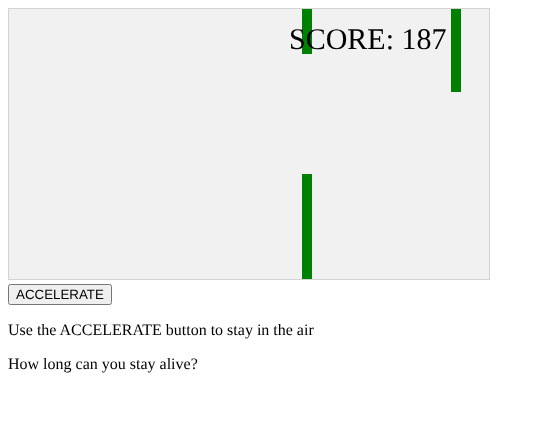
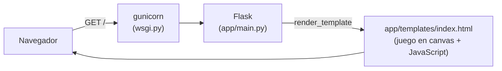

# Heroku + Flask + Repl.it

Aplicación mínima en Flask que sirve un juego de navegador, hecha como ejercicio para aprender a desplegar una aplicación web en Heroku desde Repl.it.



El juego corre completo en el navegador: se mantiene presionado **ACCELERATE** para que la pieza suba y se suelta para que caiga, esquivando los obstáculos.

## Cómo funciona



| Archivo | Para qué sirve |
|---|---|
| `app/main.py` | La aplicación Flask, con una sola ruta (`/`) |
| `app/templates/index.html` | El juego |
| `wsgi.py` | Punto de entrada para gunicorn |
| `Procfile` | Le dice a Heroku cómo arrancar la aplicación |
| `.python-version` | Versión de Python para el despliegue |

## Cómo ejecutarlo

Requiere Python 3.11 o superior.

```bash
python -m venv .venv
source .venv/bin/activate        # En Windows: .venv\Scripts\activate
pip install -r requirements.txt
flask --app app.main run
```

Abre <http://127.0.0.1:5000>. Para arrancarlo como en producción (Linux o macOS): `gunicorn wsgi:app`.

## Pruebas

```bash
pip install -r requirements-dev.txt
pytest
```

## Despliegue en Heroku

Heroku retiró su plan gratuito en noviembre de 2022, así que el despliegue ya no es gratis. Los comandos originales del ejercicio se conservan como referencia; no se volvieron a probar en esta revisión.

```bash
wget https://cli-assets.heroku.com/heroku-linux-x64.tar.gz

tar -zxf heroku-linux-x64.tar.gz

./../heroku/bin/heroku create NOMBREAPP  --buildpack heroku/python

./../heroku/bin/heroku login -i

./../heroku/bin/heroku git:remote -a NOMBREAPP

git remote add origin https://git.heroku.com/NOMBREAPP.git

git push --set-upstream origin master
```

## Recursos

- [Repl.it](https://repl.it) y [Heroku](https://heroku.com)
- Tutorial en YouTube: https://youtu.be/im9A_Q5qOJg
- La demo original estaba en `tutorial-heroku-flask.herokuapp.com`.
